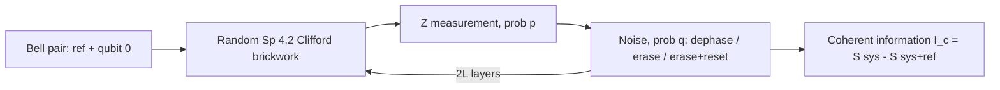
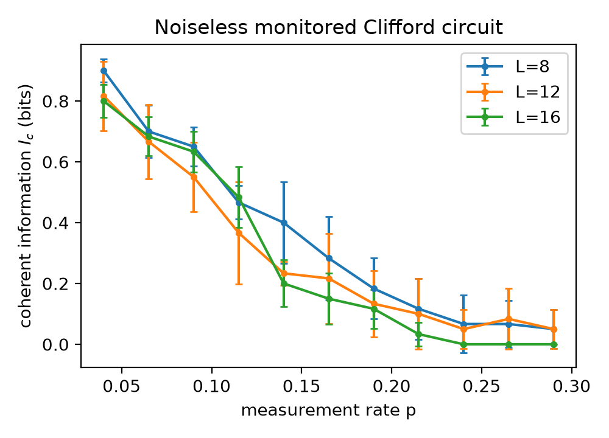
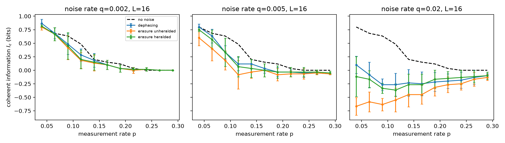
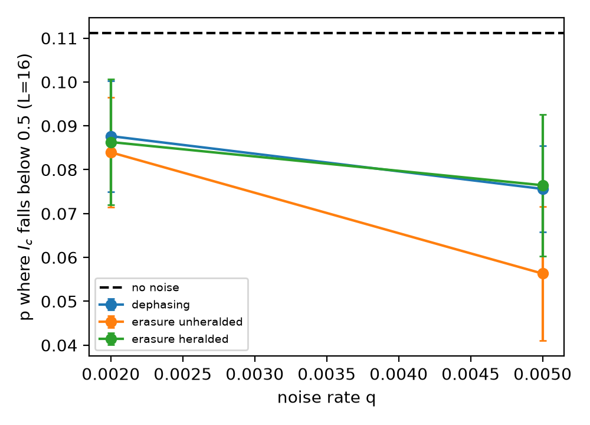

# Heralded vs unheralded noise in monitored Clifford circuits

  

## Abstract
We simulate a reference qubit entangled with a chain of qubits evolving under random brickwork Clifford gates and projective measurements, and track the coherent information the chain retains. We add three noise channels at equal event rate: unrecorded dephasing, unheralded erasure (qubit left maximally mixed) and heralded erasure (qubit reset to |0>). In this small simulation (L = 8-16), noise at q = 0.005 per qubit-layer lowers the measurement rate at which information survives, and the heralded channel is slightly less harmful than the unheralded one, but the difference is only about one seed standard deviation.

## Motivation
Monitored random circuits (Fisher et al., 2023, doi:10.1146/annurev-conmatphys-031720-030658) are a model for how measurements and scrambling compete. Experiments now combine error correction (Sivak et al., 2023, doi:10.1038/s41586-023-05782-6) and mid-circuit erasure conversion (Ma et al., 2023, doi:10.1038/s41586-023-06438-1), so errors can be known or unknown by location. See `docs/RESEARCH_GAP.md`.

**Gap / hypothesis:** at equal rate, heralded erasure leaves a higher measurement-rate threshold p_half than unheralded erasure (p_half = rate where I_c at L = 16 drops below 0.5).

## Method

Sign-free GF(2) stabiliser simulator (own code), entropy S_A = |A| − dim(G_A). Baselines: noiseless monitored circuit and unheralded channel. Details in `docs/METHOD.md`.

## Results (all from `results/`)
Threshold proxy p_half (L = 16, mean ± std over 4 seeds; `results/thresholds.csv`):

| channel | q = 0.002 | q = 0.005 | q = 0.02 |
|---|---|---|---|
| none (q=0) | 0.111 ± 0.009 | | |
| dephasing | 0.088 ± 0.013 | 0.076 ± 0.010 | undefined (I_c<0.5 at all p) |
| unheralded erasure | 0.084 ± 0.013 | 0.056 ± 0.015 | undefined |
| heralded erasure | 0.086 ± 0.014 | 0.076 ± 0.016 | undefined |

Noiseless crossing of the L = 8 and L = 16 curves: p ≈ 0.102 (`p_cross`). At q = 0.02 even p = 0.04 gives I_c = 0.10 (dephasing), −0.12 (heralded) and −0.67 (unheralded) at L = 16 (`sweep_summary.csv`).





## Discussion
- Noise reduces p_half monotonically with q; at q = 0.02 (≈0.64 events per qubit over the circuit) the retained information is gone for every channel.
- At q = 0.005, heralded erasure (0.076 ± 0.016) beats unheralded erasure (0.056 ± 0.015) by ~1.3 σ: suggestive, **not** a conclusive confirmation of the hypothesis. At q = 0.002 the three channels are indistinguishable within error.
- Dephasing behaves like heralded erasure here; we did not test why.
- Negative/caveat: the first sweep with q = 0.02 and 0.04 was uninformative for thresholds, so we lowered q. The noiseless crossing (~0.10) is below commonly quoted Clifford thresholds; finite size, finite depth 2L and Z-only measurement are likely reasons, and we did not do finite-size scaling.

## Limitations
Stabiliser (Clifford) simulation only, L ≤ 16, depth 2L, 4 seeds × 15 trajectories, Pauli-type channels, no real hardware model, I_c can be negative and is averaged raw. Threshold values are proxies, not critical points.

## Future work
Larger L with finite-size scaling, more seeds to resolve the heralded/unheralded gap, non-Clifford gates, a decoder for the unheralded case, and mapping q to erasure fractions reported on neutral-atom platforms.

## Reproducibility
```
pip install -r requirements.txt
pytest -q
python experiments/run_all.py --quick   # ~5 s
python experiments/run_all.py           # 451 s (results/meta.json)
```
Run on Windows 11, Python 3.11.9, CPU only.

Related work by the author: [xy-mixer-vs-penalty-qaoa-noise-crossover](https://github.com/pradeepdegalaroyal/xy-mixer-vs-penalty-qaoa-noise-crossover), [QEM-ZeroNoise-Extrapolation](https://github.com/pradeepdegalaroyal/QEM-ZeroNoise-Extrapolation).

## Structure
`src/monitored_codes/` simulator and circuit; `experiments/run_all.py`; `tests/`; `docs/`; `results/`; `figures/`.

## Citation
See `CITATION.cff`. License: MIT.
